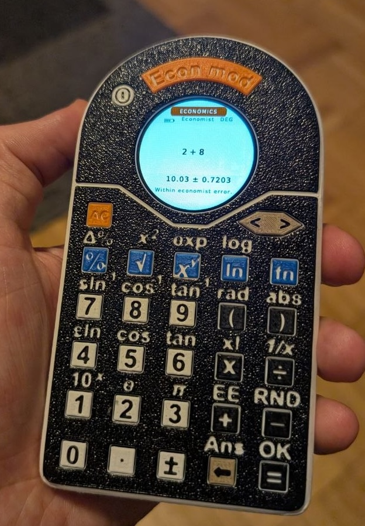
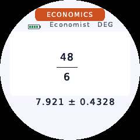
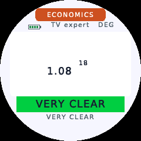
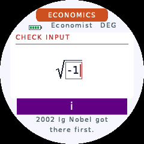
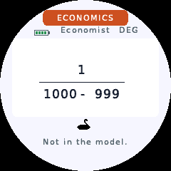
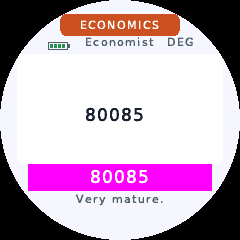
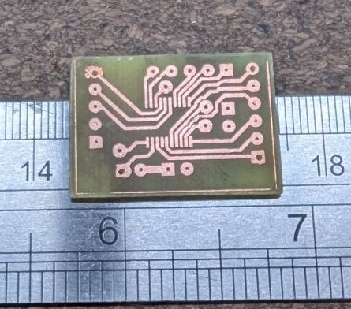
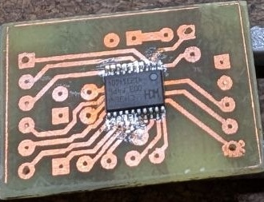
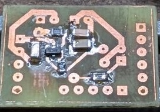
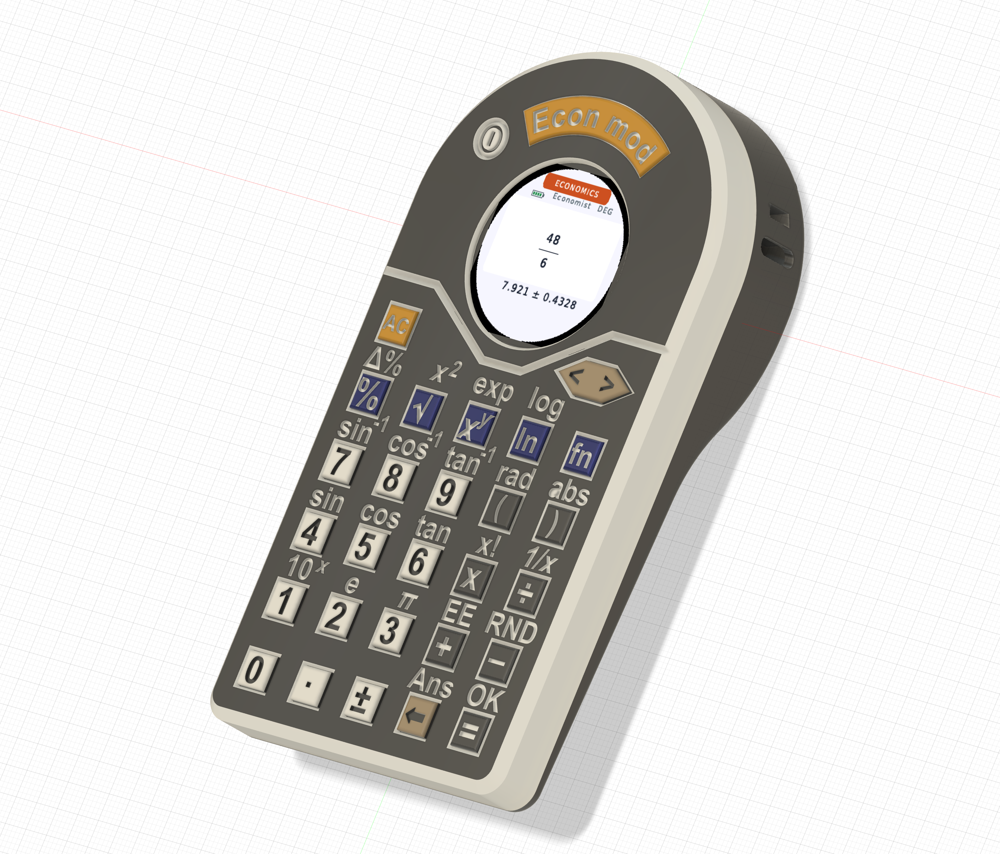

# Joke Calculator for an Economist

A homemade birthday gift for an economist: a calculator that understands the maths but makes questionable economic forecasts. It has a round colour display, physical keys, and a habit of treating uncertainty as an opportunity.

I started just five days before the birthday, so I used off-the-shelf components and made the board and enclosure at home. The firmware was vibe-coded with ChatGPT, then tested on the device.



## What it does

- **Normal:** a scientific calculator with fractions, powers, roots, logarithms, trig, DEG/RAD and Ans.
- **Uncertainty:** enter a value with its standard uncertainty, such as `100 ± 3`. The calculator propagates independent uncertainties using first-order derivatives.
- **Economics:** ordinary input. Values receive artificial, random uncertainties → the expression propagates them → the result becomes a slightly unreliable economic estimate.

The economic estimate shifts by a multiple of sigma. Its absurdity score depends on uncertainty relative to the result, cancellation, risky division and nonlinear growth. More uncertainty gives the calculator more room to misbehave. Input assumptions stay stable within a session; repeated `=` can revise the presentation.

Three personalities share that machinery: **Economist** cautiously estimates; **TV Expert** becomes more confident as the evidence gets worse; **Referee 2** finds methodological objections. Settings control idle shutdown, displayed digits and notation, and survive reboot.

**Controls:** MODE cycles Normal → Economics → Uncertainty → Settings. FN activates the secondary legends for one keypress; left/right move between expression fields, and FN + `=` advances to the next field. In Uncertainty mode, `±` enters sigma; in Normal and Economics it changes the sign. AC clears, DEL edits, and repeated `=` in Economics revisits the same model with a fresh interpretation.

Some examples of what might happen:

Usually Economics mode simply produces a plausible estimate with uncertainty, without an extra joke. Here, `48/6` becomes `7.921 ± 0.4328`:



| Unreliable growth forecast | An imaginary economic precedent |
| --- | --- |
|  |  |
| `1.08^18`: TV Expert may hide the uncertainty and insist it is **VERY CLEAR**. | `sqrt(-1)`: **2002 Ig Nobel got there first.** No complex arithmetic, just a purple `i`. |

| A denominator nobody should trust| Excellent use of equipment |
| --- | --- |
| |  |
| `1/(1000-999)`: strong cancellation can make the denominator statistically compatible with zero and invite a Black Swan. | `80085`: **Very mature.** The exact-number banner is intentional. |

These screenshots illustrate possible responses; probabilistic events do not appear every time. More examples and their trigger conditions are in the [PDF gallery](docs/econ-gallery.pdf). ECON's random function also returns exactly `1 ± 0`.

## Electronics and homemade PCB

The design is deliberately minimal: a **CH32V006F8P7**, a **GC9A01 240×240 SPI LCD**, a battery, an AliExpress battery charging/protection board, and a handful of passive components plus an LCD power switch. The keyboard is a 6×5 switch matrix. No framebuffer is needed.

The PCB was made at home: laser-print the pattern on glossy paper, iron the toner onto copper-clad board, then etch it using hair-bleach developer. The MCU was reflow-soldered on a frying pan; the remaining components were soldered by hand. These photos document the build, rather than a chemical or temperature recipe.

| Etched board | MCU soldered | Remaining components |
| --- | --- | --- |
|  |  |  |

The [KiCad schematic and PCB](kicad/) are included. The schematic uses a **CH32V003FxPx symbol**, while this firmware targets **CH32V006F8P7**; check that distinction when reproducing the board.

| Connection | MCU pin(s) |
| --- | --- |
| LCD SCK / MOSI / DC | PC5 / PC6 / PC7 |
| LCD power, active low | PD4 |
| Keyboard rows | PD6, PA1, PC0, PD0, PA2, PC1 |
| Keyboard columns | PC2, PC3, PC4, PD2, PD3 |
| Power button, active low | PD5 |

LCD CS/RST are not connected. A short power-button press enters standby; the next press wakes it. Holding the button for about two seconds resets the MCU through its interrupt handler, even if the main loop hangs.

## Case and buttons

Printed on a **Bambu Lab A1 mini with a single filament at a time**. The colours came from manually changing filament after the first four layers, rather than using a multicolour attachment.



The first button printed after a filament change tended to have a defect. Print at least two buttons on the bed and use one as a sacrificial purge piece; keep the good one.

The [3MF project](calculator.3mf) is included.

## Build and flash

Use the **WCH RISC-V GCC12 toolchain supplied with MounRiver Studio**. The build uses WCH's `rv32ec_zmmul_xw` ISA and `ilp32e` ABI; a generic RISC-V compiler is not interchangeable.

```sh
make WCH_BIN="/path/to/WCH/GCC12/bin"
make size WCH_BIN="/path/to/WCH/GCC12/bin"
```

Outputs are `build/calculator.bin`, `.hex` and `.elf`. If the WCH tools are on PATH, plain `make` works. I programmed the MCU using Ardulink on an Arduino Nano board. The supplied flashing script uses minichlink with your programmer's serial port:

```sh
./flash.sh build/calculator.bin /dev/your-programmer-port
```

The firmware uses about **61.7 KiB of flash** and **1.9 KiB of static RAM**, plus a 3 KiB reserved stack. The last 256-byte flash page stores settings. Flash space is almost full; toolchain changes can affect whether the build fits.

`User/` contains the application; `Core/`, `Debug/`, `Startup/` and `Peripheral/` supply the required WCH support. Only used peripheral driver implementations are included. Generated font data is supplied, so building needs no font-generation tools.

WCH files retain their original copyright and usage notices. The DejaVu font notice is in [licenses/LICENSE_DEJAVU](licenses/LICENSE_DEJAVU). No additional license for the original project files has been selected yet.
